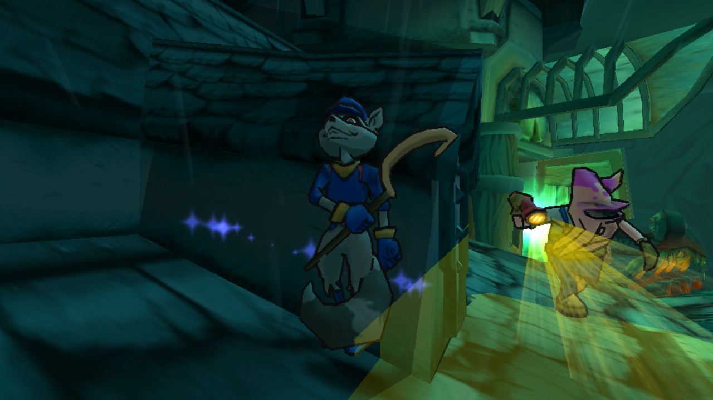
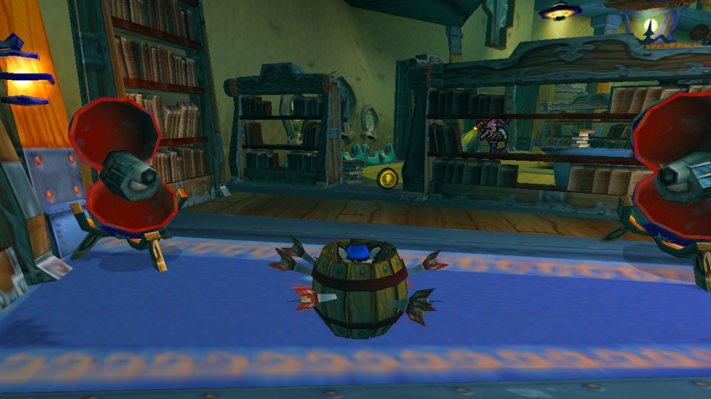
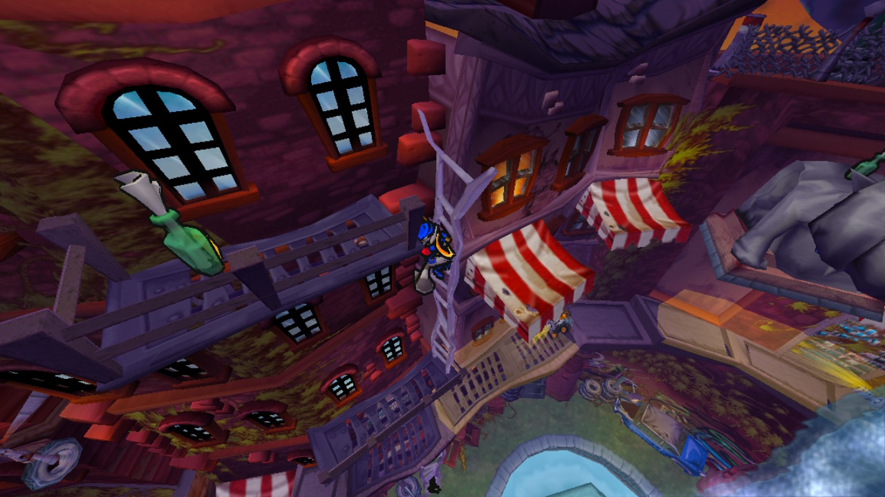
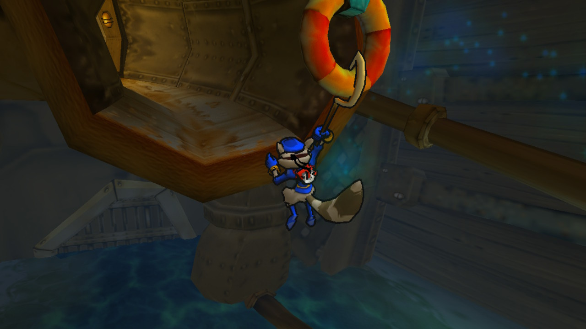

# sly1-nx

*Sly Cooper and the Thievius Raccoonus* running natively on the Nintendo Switch, and on the
iPhone and iPad.

sly1-nx is a homebrew port of the PlayStation 2 game (NTSC-U, `SCUS_971.98`). It is not an
emulator: the game's own code, from [OpenThievius](https://github.com/OpenThievius)'s matching
decompilation [sly1-decomp](https://github.com/OpenThievius/sly1-decomp), is compiled for the
Switch (or for iOS), and the port supplies what the PlayStation 2 did around it (graphics,
sound, video, the pad, saving).

It follows the PS3 and PS Vita releases (*The Sly Collection*) wherever they changed the PS2
game: a 16:9 picture, saving without a memory card, the touch screen for the Binocucom and an
inverted camera setting as on the Vita. It is built from the PS2 disc image, the original
release. It draws at 1280×720, a sharper picture than the Vita's 960×544 screen can show, and
aims for 60 frames a second where the Vita version holds 30. That makes it the definitive way
to play *Sly Cooper and the Thievius Raccoonus* on a handheld.

**Version 1.0.0** is the Switch version. All 46 levels load and run; it was developed and
tried on a Switch Lite.

**The iPhone and iPad version** is newer and not a numbered release yet: it runs, with picture,
sound, touch controls and saving, and is on `main`. See [iPhone and iPad](#iphone-and-ipad).
Most of this page describes the Switch version.

**You need your own copy of the game.** Nothing of the game is in this repository, and no
ready-made program is offered for download: you build it yourself from your own disc image
([why](#the-games-data-is-not-here)).

## Screenshots

| | |
| --- | --- |
|  |  |
|  |  |

The port's 16:9 picture at 1280×720, captured on a Switch.

## Features

- **The whole game**: all 46 levels, the bosses, the vehicle and minigame levels, the hideout
  and the world maps, with the game's own loaders reading your disc image.
- **16:9 widescreen** with a wider view (the 4:3 picture is not stretched). Counters, menus,
  captions and the Binocucom are laid out for the wide screen.
- **1280×720**, drawn by the Switch's GPU, with the characters' outlines thickened to suit the
  resolution.
- **Sound, music and voices**: the sound effects, each level's interactive music (it follows
  what you do, as on the PS2) and the streamed voices and themes.
- **All 17 videos**, decoded by the port's own MPEG-2 decoder and shown full screen.
- **Saving without a memory card**: the game's three save files kept on the SD card, with no
  memory card questions. Every save is backed up before it is overwritten.
- **Rumble**, on a console that has motors.
- **Touch screen**: touching the screen is L1 (the Binocucom), as the PS Vita release has it.
- **Extra settings** in the pause menu's Options and Controls pages:

  | Setting | What it does |
  | --- | --- |
  | Camera: Normal / Inverted | which way the right stick turns the camera |
  | Picture: Normal / Vivid | the PS2's colours, or more saturated ones |
  | Show FPS: Off / On | the frame rate in a corner |
  | Difficulty: Normal / Easy | Easy slows the enemies of four levels and nothing else ([details](docs/DIFFICULTY.md)); Normal is the game as it shipped |

- **Crash and freeze reports**: if the game faults or stops for 30 seconds, it writes a small
  text report to the SD card ([details](docs/CRASHES.md)). Nothing else is logged.

### What 1.0.0 does not have

- **A locked 60 frames a second.** The game aims for 60 and holds it in lighter scenes; busy
  ones drop below it. Measured on a Switch Lite over a tour of three levels, it held 60 for about
  six tenths of the time.
- **HD textures.** The PS3 and Vita releases have their own; the picture here is 720p with the
  PS2's textures.
- **A docked picture of its own.** Docked, the picture is the same 1280×720; the port has not
  been tried on a docked console.
- **Other versions of the game.** Only the NTSC-U disc is recognised.

How the port differs from the PS2 game, and why, is listed in
[docs/PS3_PARITY.md](docs/PS3_PARITY.md).

## What you need

- A Switch that can run homebrew, with the Homebrew Menu (hbmenu).
- Your own *Sly Cooper and the Thievius Raccoonus* disc (NTSC-U, `SCUS_971.98`), dumped to an
  `.iso` file (about 2.8 GB).
- A computer to build on (the port is built on macOS; Linux and Windows with MSYS2 should work
  the same way), with:
  - [devkitPro](https://devkitpro.org/wiki/Getting_Started) with the Switch tools: devkitA64,
    libnx, deko3d, `uam` and switch-tools (the `switch-dev` group, plus `deko3d` and `uam` if
    your installation lacks them);
  - CMake 3.16 or later and Ninja;
  - Python 3 with the `libclang` package;
  - git.

## Building

```sh
git clone --recurse-submodules https://github.com/SlyC00per/sly1-nx.git
cd sly1-nx

python3 -m venv venv
venv/bin/pip install libclang

cmake -B build-release -G Ninja \
    -DCMAKE_TOOLCHAIN_FILE=$DEVKITPRO/cmake/Switch.cmake \
    -DCMAKE_BUILD_TYPE=Release \
    -DSLY1_RELEASE=ON \
    -DSLY1_ISO="/path/to/your/Sly Cooper.iso" \
    -DPython3_EXECUTABLE=$PWD/venv/bin/python

cmake --build build-release --target sly1.nro
```

The result is `build-release/sly1.nro`.

`-DSLY1_ISO` matters: the build reads the game's vertex programs from your disc image and
translates them. Without it the program still builds but runs far too slowly to play.

## Installing

1. Copy `sly1.nro` to the SD card, under `/switch/` (for example `/switch/sly1/sly1.nro`).
2. Copy your disc image into `/switch/sly1/`. Any file name will do: the port finds the disc by
   its contents.
3. Start the Homebrew Menu **through a game** (hold R while starting any installed game), not
   through the Album: the port has only been run that way, with a game's full memory.
4. Start **Sly Cooper** from the list. Its version line reads `1.0.0`.

If the disc image is missing or is not the NTSC-U disc, the screen says so and what to do.

## Controls

The buttons are where the PlayStation's are, by position.

| Switch | PlayStation 2 |
| --- | --- |
| B | Cross (jump) |
| A | Circle (the thief moves, at blue sparkles) |
| Y | Square (the cane) |
| X | Triangle |
| L, or a touch of the screen | L1 (the Binocucom) |
| R, ZL, ZR | R1, L2, R2 |
| + | Start (pause) |
| − | Select |
| Left stick, right stick | move, turn the camera |

## Saves

Saves are in `/switch/sly1/save/` on the SD card, in the game's own format. Before a save is
written over, it is copied to `/switch/sly1/save-backups/`: the first one ever made is kept for
good, with copies from each session and the most recent ones.

Pressing + during the opening scene on the Paris rooftop begins a **new game**, as on the PS2;
to go on with a save, choose it at the title.

## iPhone and iPad

The same game from the same source, drawn by a renderer written for Apple's GPUs. It is a work
in progress: it has been played on an iPhone Duo (iOS 27), an iPhone 15 Pro Max (iOS 17) and a
2018 iPad Pro, and only its first levels have been played there.

What it has:

- **The picture in the screen's own shape**, with nothing stretched and no black bars, at up
  to 1,080 pixels along the shorter side. The view is wider on a wide screen and taller on a
  tall one.
- **Sound, music, voices and the videos**, as on the Switch.
- **Touch controls**: the left side of the screen is the move stick, the right side the
  camera, and the buttons are drawn over the picture. On an iPad they sit on the lower half,
  at the edges.
- **A folding phone's postures**: closed or open on its side; folded half way, with the picture
  on the upper half and the controls on the lower; and open and upright, with the picture
  filling the screen.
- **Choosing the disc image** in the Files browser (iCloud Drive included) the first time; it
  is copied into the app's folder and not asked for again.
- **Saves** in the app's folder (`save/`), in the game's own format, with the same backups as
  on the Switch.
- **Pausing** when you leave the app, and going on when you come back.

What it does not have yet:

- **A frame rate measured over the whole game.** The game's own counter (Show FPS, in Options)
  reads 60 on all three devices in the levels played so far; no level-by-level measurement has
  been made, and the phones get warm.
- **A tried controller.** The code for a Bluetooth or USB controller is there, and has not been
  used with one.
- **Rumble**, and the Switch's crash reports.
- **A look at every screen in an upright picture.** The menus, the counters and the Binocucom
  have not been checked in that shape.

To build it you need a Mac with Xcode, an Apple ID added to Xcode (a free one will do: the app
then opens for seven days after each install; with a paid developer membership, a year), your
disc image, and CMake and Python as for the Switch. iOS 16 or later.

```sh
python3 -m venv venv
venv/bin/pip install libclang

cmake -B build-ios -G Xcode -DCMAKE_SYSTEM_NAME=iOS -DPLATFORM=HOST \
    -DSLY1_ISO="/path/to/your/Sly Cooper.iso" \
    -DSLY1_IOS_TEAM=YOURTEAMID -DSLY1_IOS_BUNDLE_ID=an.identifier.of.your.own \
    -DPython3_EXECUTABLE=$PWD/venv/bin/python
```

Then open `build-ios/sly1_nx.xcodeproj` in Xcode, choose the `sly1_ios` target and your device
(with Developer Mode turned on in its Settings, under Privacy & Security), and run. The first
screen asks for your disc image. [docs/IOS.md](docs/IOS.md) has the rest, including the same
renderer in a window on the Mac.

## If something goes wrong

A crash or a freeze leaves a report in `/switch/sly1/crashes/` (`fault-…txt` or `hang-…txt`).
It says which build it was, the level, where each thread stood and the last things the game
did. To read the addresses in one, keep the `sly1.elf` the build made beside your `sly1.nro`
and run:

```sh
python3 tools/crash_report.py REPORT.txt --elf build-release/sly1.elf
```

## The game's data is not here

This repository holds only the port's own code, build files and documentation. The game's code
comes from the decompilation, a separate repository taken as a git submodule, and the game's
data comes from your own disc image, read as the game runs. No disc image, executable,
extracted asset, texture, compiler or SDK file is in this repository, and none is ever
committed to it (`tools/proprietary.py` checks what is committed).

A built `sly1.nro`, or a built iOS app, holds the game's compiled code and the vertex programs
translated from your disc. That is why none is offered for download, and why you should not
pass yours on.

## How it works, and where to read more

The game's source is compiled as it is: the port never edits the decompilation. A generation
step rewrites what a 64-bit machine needs (the game keeps its 32-bit addresses), and a small
set of named patches (`tools/patches.py`) carries the port's own changes, each with its reason.
Under the game sit replacements for the PS2's parts: a graphics layer that takes the game's
own drawing packets, a sound engine that answers the commands the game sent to Sony's driver,
an MPEG-2 decoder, the pad, and the memory card as a folder.

- [docs/PS3_PARITY.md](docs/PS3_PARITY.md): every way the port differs from the PS2 game.
- [docs/DESIGN.md](docs/DESIGN.md): the port's design.
- [docs/RENDERER.md](docs/RENDERER.md): the renderer, and the work on the frame rate.
- [docs/IOS.md](docs/IOS.md): the iPhone and iPad version, its Metal renderer and the Mac's window.
- [docs/AUDIO.md](docs/AUDIO.md) and [docs/VIDEO.md](docs/VIDEO.md): sound, music and videos.
- [docs/DIFFICULTY.md](docs/DIFFICULTY.md): what the Easy setting changes.
- [docs/CRASHES.md](docs/CRASHES.md): the crash and freeze reports.
- [docs/RECEIVER.md](docs/RECEIVER.md): running builds on a Switch from the computer.
- `CLAUDE.md` and [docs/BRIEF.md](docs/BRIEF.md): the rules and commands for working here.
- `sly1-decomp/docs/PORTING.md`: where every PS2-specific part of the game is.

## Credits

The port stands on [OpenThievius](https://github.com/OpenThievius)'s
[sly1-decomp](https://github.com/OpenThievius/sly1-decomp), the matching decompilation of the
game: every line of game code the port compiles comes from it, unedited. Without that work
there would be no port.

## Licence

The port's code is AGPL-3.0-or-later; see `LICENSE`. *Sly Cooper and the Thievius Raccoonus*
belongs to its owners; this project is not affiliated with or endorsed by them.
